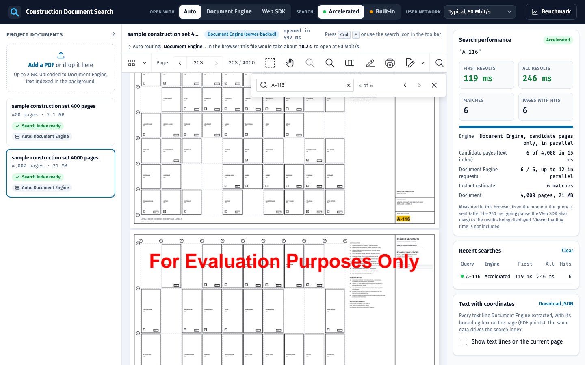
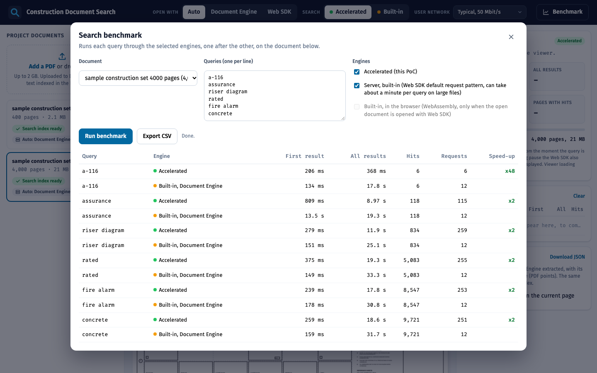

# Nutrient Large PDF Search

A Nutrient.io demo that searches construction drawing sets and spec books of 400 to 4,000 pages in about a second, with Document Engine doing the search and the standard Web SDK search UI showing the results.



1. **Upload.** Each PDF of the `documents` folder, or dropped in the browser (up to 2 GB), is uploaded once to Nutrient Document Engine.
2. **Page text index.** Right after upload, the app asks Document Engine for the text of every page (`GET /api/documents/:id/pages/:n/text`, lines with coordinates) and stores it in one JSON file per document.
3. **Search.** When the user types in the Web SDK search UI (Ctrl+F), the app catches `search.termChange`. The page text index returns the pages that can contain the query in a few milliseconds. Only those pages are searched by Document Engine (`GET /api/documents/:id/search`), in parallel and starting from the page on screen.
4. **Results.** Hits stream back as NDJSON and are pushed into the viewer with `instance.setSearchState()`. The result counter, highlights and next and previous buttons are the standard Web SDK ones. Hit counts are the same as with the built-in search: same phrase matching, same highlight rectangles.
5. **Load routing.** At upload, the app builds a profile of the document (size, page count, large-format sheets, pages without text). **Open with: Auto** opens small files in the browser with WebAssembly and large ones server-backed, where Document Engine renders the pages and the browser never downloads the PDF.
6. **Targeted OCR.** Pages without a text layer (scans, rasterised sheets) are OCR'd by Document Engine in the background. Pages that already have text are not touched.

Everything runs on Nutrient products: viewing, rendering, text extraction, search, highlights, OCR and storage are Document Engine and Web SDK. The PoC code is about 300 lines that decide which pages to search and in which order (`app/src/text-index.js`, `app/src/search.js`) and about 150 lines in the browser that feed the hits to the Web SDK search UI (`runAccelerated` in `app/public/app.js`).

### Performance

Search time grows with the number of pages that contain the query, not with the size of the document. Specific queries (sheet numbers, spec sections, products) are answered completely in well under a second, even on a 4,000-page set. Words found on most pages take longer, but their first hits show within a few hundred milliseconds. More CPU cores for Document Engine divide the time further.

Run the same comparison on your own files with the **Benchmark** button or `docker compose exec app npm run bench`.

## Prerequisites

- Docker Desktop with at least 8 GB of memory and 4 CPUs (Settings > Resources)
- Free ports 4000 (app) and 5200 (Document Engine), or other ports set in `.env`
- Free disk space of about 3 times the size of your PDFs
- OpenSSL, to generate the local keys
- Node.js 20 or later and npm, only to generate the sample PDF

## Environment variables

Copy `.env.example` to `.env`. Docker Compose reads it automatically. License keys are only read from environment variables, never from code.

| Variable | Purpose | Default |
|---|---|---|
| `ACTIVATION_KEY` | Document Engine activation key or offline license key | empty = evaluation mode |
| `WEB_SDK_LICENSE_KEY` | Web SDK license key, served to the browser by `GET /api/config` and used when a document opens in the browser | empty = evaluation mode |
| `POSTGRES_PASSWORD` | Local PostgreSQL password used by Document Engine | `change-me`, change it |
| `DASHBOARD_PASSWORD` | Document Engine dashboard password (<http://localhost:5200/dashboard>, user `dashboard`) | `change-me`, change it |
| `APP_PORT` | Host port of the app | `4000` |
| `DOCUMENT_ENGINE_PORT` | Host port of Document Engine. The browser loads pages and tiles from it in server-backed mode | `5200` |

In evaluation mode, Document Engine shows a watermark on every page, accepts input files up to 50 MB and stops any processing step after 100 seconds. The generated sample PDFs stay below that size (about 21 MB for 4,000 pages). Ask Nutrient for an evaluation license key to test larger files.

`scripts/generate-keys.sh` writes the other secrets to `keys/`, which is not committed:

| File | Content |
|---|---|
| `keys/jwt-private.pem` | RSA key the app uses to sign a short-lived JWT per document for the viewer |
| `keys/jwt-public.pem` | Matching public key |
| `keys/document-engine.env` | `JWT_PUBLIC_KEY`, `API_AUTH_TOKEN` and `SECRET_KEY_BASE` for Document Engine |
| `keys/app.env` | `DE_API_TOKEN` for the app, the same value as `API_AUTH_TOKEN` |

Tuning variables are set in `docker-compose.yml`:

| Variable | Purpose | Default |
|---|---|---|
| `SEARCH_CONCURRENCY` | Parallel Document Engine requests per search, about the number of CPU cores of the Document Engine host | `12` |
| `INDEX_CONCURRENCY` | Parallel page text requests while a document is indexed | `8` |
| `MAX_PAGES_PER_REQUEST` | Largest page window in one search request | `16` |
| `CLIENT_BANDWIDTH_MBPS` | User bandwidth assumed by **Open with: Auto** | `50` |
| `MAX_CLIENT_OPEN_SECONDS`, `MAX_CLIENT_MB`, `MAX_CLIENT_PAGES`, `MAX_CLIENT_LARGE_FORMAT_PAGES` | Limits for opening a document in the browser | `5`, `150`, `1500`, `50` |
| `AUTO_OCR` | OCR the pages without text after upload | `true` |
| `MIN_SEARCH_QUERY_LENGTH` (Document Engine) | Shortest query, 2 so that sheet tags such as `A2` can be searched | `2` |

## Build and run

```bash
cp .env.example .env
```

```bash
./scripts/generate-keys.sh
```

Put your PDFs in `documents/`, or generate a synthetic construction set:

```bash
npm install
```

```bash
npm run generate-sample
```

This writes `documents/sample-construction-set-400-pages.pdf` (about 2 MB): 240 drawing sheets of 36 x 24 in with sheet numbers, room names, keyed notes and title blocks, then 160 letter pages of specification sections. Every word is real text, so it can be searched. For a bigger file:

```bash
node scripts/generate-sample-pdf.mjs --pages 4000
```

Start Document Engine, PostgreSQL and the app:

```bash
docker compose up -d --build
```

Open <http://localhost:4000> in Chrome, Edge or Safari.

On first start, each PDF of `documents/` is uploaded to Document Engine, then its page text is extracted: a few seconds for the generated 400-page sample and a few minutes for the generated 4,000-page one, whose pages hold many short text lines. The library on the left shows the progress.

```bash
docker compose down
```

stops everything, and

```bash
docker compose down -v
```

also deletes the uploaded documents and the text index.

## Using the app

1. Pick a document in the library on the left, or drop a PDF on it.
2. Press Ctrl+F (Cmd+F on a Mac) or click the search icon of the viewer toolbar, and type a query.
3. The **Search performance** panel shows the time to the first and to all results, the number of matches and pages, and how much work Document Engine did. Every search is added to **Recent searches**, so you can compare engines side by side.
4. Switch **Search** between **Accelerated** (this PoC) and **Built-in** (the viewer's own search) at any time.
5. Switch **Open with** between **Auto**, **Document Engine** (server-backed) and **Web SDK** (the PDF is downloaded and opened in the browser). The line under the document title says which loader was used and why. **User network** changes the bandwidth Auto assumes.
6. **Benchmark** runs a list of queries through the engines on a document and builds a comparison table you can export as CSV. The queries are pre-filled from the document itself: a reference code, a rare word, a mid-frequency word, a common phrase and a very frequent word.

   

   The generated sample repeats a small vocabulary, so most of its words are on a large share of the pages and only codes such as sheet numbers show the full gain. Real drawing sets and spec books have far more specific terms, so the gain is larger on them. From a terminal:

   ```bash
   docker compose exec app npm run bench
   ```

   ```bash
   docker compose exec app npm run bench -- <document-id> "fire alarm" concrete
   ```

7. **Scanned pages** shows the pages without a text layer and the OCR progress. They are OCR'd automatically after upload. All of them are extracted and OCR'd in one pass, then put back into the document, which is about twice as fast as OCR'ing scattered page ranges one by one.
8. **Text with coordinates** shows every text line Document Engine extracted, with its bounding box, as an overlay on the current page, or downloads it as JSON for the whole document.

## API

| Method and path | Description |
|---|---|
| `GET /api/config` | `{ serverUrl, webSdkLicenseKey, routing, searchConcurrency }` |
| `GET /api/health` | `{ app, documentEngine }` |
| `GET /api/documents` | Library: status, page count, index and OCR progress, profile and load plan of each document |
| `POST /api/documents?name=file.pdf` | Raw PDF body. Streamed to disk, then uploaded to Document Engine and indexed in the background. Returns `202` |
| `DELETE /api/documents/:id` | Deletes an uploaded document from Document Engine and the index |
| `GET /api/documents/:id/load-plan?bandwidth=50` | `{ profile, mode, reasons, estimate }`: `server` or `browser`, and why |
| `GET /api/documents/:id/session` | `{ serverUrl, documentId, jwt }` for a server-backed viewer |
| `GET /api/documents/:id/source.pdf` | The original PDF, for the in-browser mode |
| `GET /api/documents/:id/search?q=...&from=<page>` | Accelerated search, NDJSON stream: `plan`, then `hits` per Document Engine request, then `done` |
| `GET /api/documents/:id/pages/:page/lines` | Text lines of one page with their bounding boxes in PDF points |
| `GET /api/documents/:id/text-lines.json` | Text lines of the whole document |
| `GET /api/documents/:id/suggestions` | Test queries derived from the document |
| `POST /api/documents/:id/ocr` | `{ language }`, OCRs the pages without text. Returns `202` |
| `POST /api/bench` | `{ docId, queries, engines }`, NDJSON stream of benchmark rows |

## Taking it into your application

Three pieces, independent of the UI of this demo:

1. After uploading a PDF to Document Engine, extract the text of each page once and store it next to the document (`buildIndex` in `app/src/text-index.js`).
2. A search endpoint that turns a query into candidate pages and runs Document Engine's `/search` on them in parallel, streaming the hits (`acceleratedSearch` in `app/src/search.js`).
3. In the Web SDK, listen to `search.termChange`, call `event.preventDefault()`, call your endpoint and push the hits with `instance.setSearchState()` (`onTermChange` and `runAccelerated` in `app/public/app.js`).

Why it is fast: the expensive part of a server-side search on a 500 MB drawing set is Document Engine reading every page of the PDF. The page text index tells it, in a few milliseconds, which pages to read. Document Engine still does the matching and computes the highlight rectangles, so the results are those of its normal search. A query found on 20 pages costs 20 pages of work instead of 4,000, and those pages are read in parallel.

## Production notes

- **Storage.** This PoC stores PDFs in PostgreSQL (built-in storage), which caps one file at 1 GB. Use S3-compatible storage or Azure Blob Storage for large documents (`ASSET_STORAGE_BACKEND`).
- **Viewing large sheets.** Enable HTTP/2 shared rendering in Document Engine (`HTTP2_SHARED_RENDERING_PROCESS_ENABLE`) behind an HTTP/2 proxy to remove per-tile overhead when users pan and zoom.
- **Sizing.** Search throughput scales with the CPU cores given to Document Engine (`PSPDFKIT_WORKER_POOL_SIZE`). Document Engine scales horizontally. The page text index is a plain JSON file per document and can live in your database or object storage.
- **Security.** The browser only gets a short-lived JWT per document, signed by the app. The Document Engine API token never leaves the server.

## Files

| Path | Content |
|---|---|
| `docker-compose.yml` | Document Engine 1.19, PostgreSQL 16 and the app |
| `scripts/generate-keys.sh` | JWT key pair and Document Engine tokens in `keys/` |
| `scripts/generate-sample-pdf.mjs` | Synthetic construction set generator (pdf-lib) |
| `documents/` | PDFs imported at start-up, not committed |
| `app/src/server.js` | HTTP API: upload, viewer session, search, OCR, benchmark, text lines |
| `app/src/search.js` | Accelerated search: candidate pages, parallel, streamed |
| `app/src/text-index.js` | Page text index built from Document Engine |
| `app/src/library.js` | Import, upload, indexing and OCR jobs |
| `app/src/ocr.js` | Targeted OCR, pages without text only |
| `app/src/load-routing.js` | Document profile and **Open with: Auto** decision |
| `app/src/bench.js` | Benchmark: built-in request pattern compared with accelerated |
| `app/src/de.js` | Thin Document Engine HTTP client |
| `app/public/` | The web page: Web SDK viewer and panels |

The app serves the Web SDK from the `@nutrient-sdk/viewer` npm package installed in its Docker image (`/vendor/nutrient`).

## Troubleshooting

- `docker compose up` stops with `env file .../keys/app.env not found`: run `./scripts/generate-keys.sh` first.
- `docker compose up` hangs on `load metadata for node:22-slim`: the Docker credential helper is stuck. Run `docker pull node:22-slim` once, or restart Docker Desktop.
- A document stays in **Uploading**: check `docker compose logs app` and `docker compose logs document_engine` (file above 2 GB, file above the evaluation limit, or Docker out of memory).
- Port 5000 is not used on purpose (macOS AirPlay uses it). Document Engine is published on 5200, the app on 4000.
